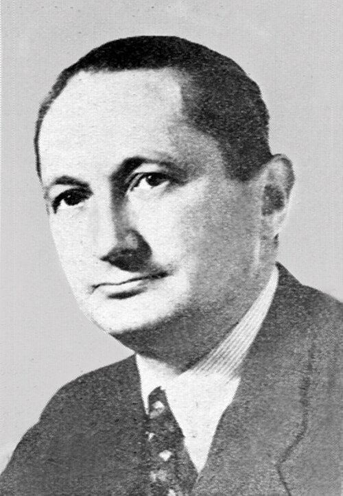
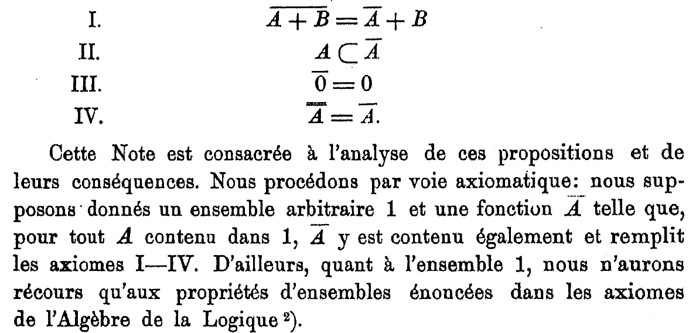

The notion of open set has a classical set-theoretic definition, by
its properties under unions and intersections. But there is another
way to define /open/ and /closed/, via an /operator/. This definition
is equivalent to the usual one, and I find that it matches our
intuition nicely, both for topological spaces and continuity.

This alternative definition is due to [[https://en.wikipedia.org/wiki/Kazimierz_Kuratowski][Kazimierz Kuratowski]] (1896--1980),
a Polish mathematician [fn:kuratowski] who worked mainly on set
theory, topology, and graph theory.

[fn:kuratowski] {^-}
#+ATTR_HTML: :width 200px :alt Photograph of Kazimierz Kuratowski in 1959

Kazimierz Kuratowski in 1959 (from [[https://en.wikipedia.org/wiki/Kazimierz_Kuratowski][Wikipedia]])

#+TOC:

* The classical definition of open sets and topology

Let $X$ be a set and $\mathcal{P}(X)$ its power set (the set of all subsets
of $X$).

#+attr_html: :id def-topology
#+begin_definition
A subset $\mathcal{U} \subseteq \mathcal{P}(X)$ is a /topology/ on $X$,
and its elements are called /open sets/, if the following hold:
- /(i)/ :: The empty set $\emptyset$ and the set $X$ are open,
- /(ii)/ :: $\mathcal{U}$ is closed under arbitrary unions: for any
  collection $(U_i)_{i\in I}$ of open sets, $\bigcup_{i\in I} U_i$ is
  open,
- /(iii)/ :: $\mathcal{U}$ is closed under finite intersections: for
  any $U_1, \dots, U_n$ open, $\bigcap_{i=1}^n U_i$ is open.

The pair $(X, \mathcal{U})$ is called a /topological space/. A set is
/closed/ if its complement is open.
#+end_definition

This definition makes sense if you already have an intuition for what
an open set is, but at first it can seem a little arbitrary: why are
we allowed arbitrary unions but only /finite/ intersections? And can't
we define what an open set /is/ instead of giving properties of the
set of open sets?

* Another way to define closure: the Kuratowski closure operator

[fn:axioms]

[fn:axioms] {^-}
#+ATTR_HTML: :width 400px :alt The closure axioms in Kuratowski's original article (in French)

The closure axioms in Kuratowski's [[https://matwbn.icm.edu.pl/ksiazki/fm/fm3/fm3121.pdf][original article]] (in French)]

#+attr_html: :id def-closure
#+begin_definition
A /Kuratowski closure operator/ is a function $c : \mathcal{P}(X) \to
\mathcal{P}(X)$ such that:
- /(a)/ :: It preserves the empty set: $c(\emptyset) = \emptyset$,
- /(b)/ :: It is /extensive/: for all $A \subseteq X$, $A \subseteq c(A)$,
- /(c)/ :: It is /idempotent/: for all $A \subseteq X$, $c(A) = c(c(A))$,
- /(d)/ :: It preserves unions: for all $A, B \subseteq X$, $c(A \cup B) = c(A) \cup c(B)$.

These are called the [[https://en.wikipedia.org/wiki/Kuratowski_closure_axioms][Kuratowski closure axioms]].
#+end_definition

Informally, $c(A)$ is the set of points that are "close" to $A$. From
such an operator, we can say that a set $A$ is /closed/ if it is left
unchanged by $c$, i.e. if $c(A) = A$, and /open/ if its complement is
closed.

An immediate property of this operator is that it is monotone with
respect to inclusion in $X$, which is consistent with the intuition
behind "closeness":

#+attr_html: :id prop-monotone
#+begin_proposition
A Kuratowski closure operator $c$ is monotone with respect to
inclusion: for any $A, B \subseteq X$, if $A \subseteq B$, then $c(A)
\subseteq c(B)$.
#+end_proposition

#+begin_proof
Let $A, B \subseteq X$ such that $A \subseteq B$. We have:

\begin{align*}
A \cup B &= B \\
c(A \cup B) &= c(B)
\end{align*}

From property /(d)/ of [[def-closure]]:

\[ c(A) \cup c(B) = c(B)  \]

and therefore $c(A) \subseteq c(B)$.
#+end_proof

* Equivalence of definitions

** From topology to Kuratowski closure

If we have a topology for which properties /(i)-(iii)/ of [[def-topology]] hold, we can define an operator $c$ as:

\[ c(A) = \bigcap \left\{ F:\; A \subseteq F, \; F \text{ closed} \right\}. \]

From the definition, it is easy to see that for all $A \subseteq X$,
$c(A)$ is closed.  Indeed, by [[https://en.wikipedia.org/wiki/De_Morgan%27s_laws][de Morgan's laws]], $X \setminus c(A)$ is
a union of open sets, and therefore is open.

#+attr_html: :id prop-closure
#+begin_proposition
$c$ is a Kuratowski closure operator.
#+end_proposition

#+begin_proof
Let us prove all the properties in [[def-closure]].

$c(\emptyset)$ is the intersection of all closed sets that contain the
empty set; since the empty set itself is closed, $c(\emptyset) =
\emptyset$, proving /(a)/.

For /(b)/, let $A \subseteq X$. $c(A)$ is the intersection of sets that
are supersets of $A$, so $A \subseteq c(A)$.

For /(c)/:
\[ c(c(A)) = \bigcap \left\{ F:\; c(A) \subseteq F, \; F \text{ closed} \right\} \]

But $c(A)$ itself is closed, so the intersection is $c(A)$ itself and $c(c(A)) = c(A)$.

Let us now turn to /(d)/, proving the equality by proving inclusion in both directions.

\[ c(A \cup B) = \bigcap \left\{ F:\; A \cup B \subseteq F, \; F \text{ closed} \right\} \]

If $F$ is closed and contains $A \cup B$, it contains $A$ and $B$ as well, so $c(A) \subseteq c(A \cup B)$ and $c(B) \subseteq c(A \cup B)$, and

\[ c(A) \cup c(B) \subseteq c(A \cup B). \]

Conversely, since $A \subseteq c(A)$ and $B \subseteq c(B)$, we have

\[ A \cup B \subseteq c(A) \cup c(B). \]

Both $c(A)$ and $c(B)$ are closed, so by /(iii)/ with de Morgan's laws, $c(A) \cup c(B)$ is closed as well.
Hence $c(A \cup B) \subseteq c(A) \cup c(B)$, completing the equality.
#+end_proof

** From Kuratowski closure to topology

#+attr_html: :id prop-topology
#+begin_proposition
If $c: \mathcal{P}(X) \to \mathcal{P}(X)$ is a Kuratowski closure
operator, it induces a topology on $X$.
#+end_proposition

#+begin_proof
For /(i)/, we can see that $c(\emptyset) = \emptyset$ by /(a)/, and by
/(b)/, $X \subseteq c(X)$ so $c(X) = X$. Therefore both $\emptyset$ and
$X$ are closed and both are open.

For /(ii)/, let $(F_i)_{i\in I}$ be a collection of closed sets,
i.e. for all $i \in I$, $c(F_i) = F_i$.
Then
\[ \forall j \in I, \bigcap_{i\in I} F_i \subseteq F_j, \]

and by [[prop-monotone]],
\[ \forall j \in I, c\left( \bigcap_{i\in I} F_i \right) \subseteq c(F_j). \]

Hence
\[ c\left( \bigcap_{i\in I} F_i \right) \subseteq \bigcap_{i\in I} c(F_i) = \bigcap_{i\in I} F_i. \]

By /(b)/,
\[ \bigcap_{i\in I} F_i \subseteq c\left( \bigcap_{i\in I} F_i \right), \]

so $\bigcap_{i\in I} F_i = c\left( \bigcap_{i\in I} F_i \right)$ and the intersection of all $(F_i)_{i\in I}$ is closed.
Therefore an arbitrary intersection of closed sets is closed, and by de Morgan, an arbitrary union of open sets is open.

Now we turn to /(iii)/ of [[def-topology]]. Let $A, B \subseteq X$ be
closed. By /(d)/,

\begin{align*}
c(A \cup B) &= c(A) \cup c(B) \\
  &= A \cup B.
\end{align*}

So $A \cup B$ is closed, and any finite union of closed sets is closed, which completes the proof.
#+end_proof

* Idempotence

Looking at the proof of [[prop-topology]], we notice that we never used
property /(c)/ of the Kuratowski closure, the one related to
idempotence. This is because we don't actually need it to prove the
equivalence between the Kuratowski closure axioms and the topology
axioms!

It is usually present in the list because it matches our intuition
nicely about "closeness". Without the idempotence axiom, the operator
is called a [[https://en.wikipedia.org/wiki/Preclosure_operator][preclosure operator]] or Čech closure operator.

So if we start from the open sets definition of a topology
([[def-topology]]), the natural closure operator associated with it will
be idempotent.

On the other hand, we can take a preclosure operator ([[def-closure]]
without /(c)/ idempotence) and define a valid topology (such a space
where the closure operator is not assumed idempotent is called a
[[https://en.wikipedia.org/wiki/Pretopological_space][pretopological space]]). Of course we can now take this topology and
define a new closure operator which will be idempotent!

* Continuity

Topological spaces are the natural context in which to define
continuity. So it is natural to ask: how does the definition translate
in terms of closure operators?

As a reminder, a function is said to be continuous if the preimage of
any open set is open:

#+attr_html: :id def-continuity
#+begin_definition
Let $X$ and $Y$ be topological spaces. A function $f: X \to Y$ is
/continuous/ if for every open set $U$ in $Y$, $f^{-1}(U)$ is open in
$X$.
#+end_definition

We can now express continuity in terms of closure operators: a
continuous function maps points /close/ to $A$ to points close to
$f(A)$.

#+attr_html: :id prop-continuity
#+begin_proposition
Let $X$ and $Y$ be topological spaces, with associated closure
operators $c_X$ and $c_Y$.

A function $f: X \to Y$ is continuous if, and only if, for all $A
\subseteq X$,

\[ f(c_X(A)) \subseteq c_Y(f(A)). \]
#+end_proposition

#+begin_proof
To simplify the notation, we will denote both $c_X$ and $c_Y$ as $c$.

Assume that $f$ is continuous.

\[ c(f(A)) = \bigcap \left\{ F:\; f(A) \subseteq F, \; F \text{ closed} \right\} \]

Since $f(A) \subseteq c(f(A))$, $A \subseteq f^{-1}(c(f(A)))$.
Moreover, since $c(f(A))$ is closed and $f$ is continuous, $f^{-1}(c(f(A)))$ is closed. So

\[ c(A) \subseteq f^{-1}(c(f(A))), \]

and by applying $f$ on both sides, 

\[ f(c(A)) \subseteq c(f(A)). \]

Now we show the converse implication. Recall that $f$ is continuous if
and only if the preimage of every closed set is closed. Let $F
\subseteq Y$ closed. We have

\[ f(c(f^{-1}(F))) \subseteq c(f(f^{-1}(F))) \subseteq c(F) = F. \]

Since every element of $c(f^{-1}(F))$ has its image by $f$ in $F$, it
belongs to $f^{-1}(F)$, so

\[ c(f^{-1}(F)) \subseteq f^{-1}(F), \]

and by /(b)/, $f^{-1}(F) \subseteq c(f^{-1}(F))$, so

\[ f^{-1}(F) = c(f^{-1}(F)), \]

and $f^{-1}(F)$ is closed. Therefore $f$ is continuous.
#+end_proof

* Conclusion

What I find most interesting about this alternative formalization of a
topology is that it is easy to see which axioms are essential and
which are not: we have seen that idempotence is not actually needed to
recover a topology from the closure axioms.

We have also seen that axiom /(d)/ (preservation of unions) implies
monotonicity ([[prop-monotone]]). If we replace axiom /(d)/ with
monotonicity itself, we end up with a [[https://en.wikipedia.org/wiki/Closure_operator][closure operator]], whose
instances include convex hulls, linear spans, and algebraic
closures. Among all closure operators, topologies are identified by
the preservation of unions.
